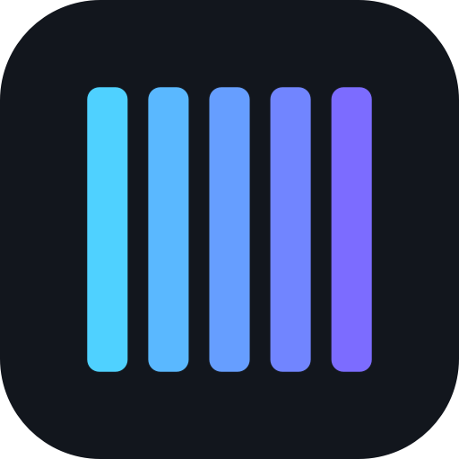
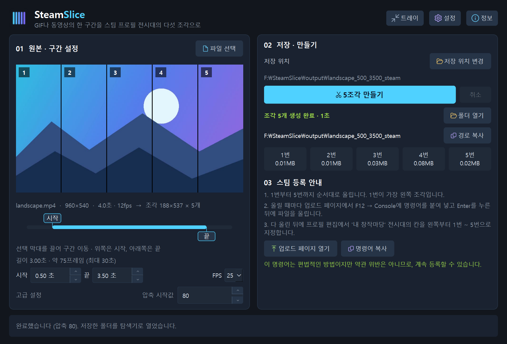

<p align="center"></p>
<h1 align="center">SteamSlice</h1>
<p align="center"><b>하나의 움직이는 그림을, 스팀 전시대의 다섯 조각으로.</b><br>GIF와 동영상 구간을 스팀 프로필 창작마당 전시대용으로 만드는 Windows 프로그램입니다.</p>

<p align="center">
  <a href="https://github.com/deuxdoom/SteamSlice/releases/latest"></a>
  <a href="https://github.com/deuxdoom/SteamSlice/releases"></a>
  
  
</p>

<p align="center"><a href="assets/main-window.png"></a></p>

<p align="center">
  <a href="https://github.com/deuxdoom/SteamSlice/releases/download/v1.0.0/SteamSlice_v100.zip"></a>
  <a href="https://deuxdoom.github.io/SteamSlice/"></a>
</p>
<p align="center">현재 공개 버전: <a href="https://github.com/deuxdoom/SteamSlice/releases/tag/v1.0.0"><b>v1.0.0</b></a> · Windows 10/11 x64<br>ZIP 전체를 풀고 SteamSlice.exe를 실행하세요. bin 폴더도 함께 있어야 합니다.</p>

<p align="center"><a href="#빠른-시작">빠른 시작</a> · <a href="#주요-기능">주요 기능</a> · <a href="#설정과-트레이">설정과 트레이</a> · <a href="#업데이트">업데이트</a> · <a href="CHANGELOG.md">변경 기록</a></p>

## 📌 소개

스팀 창작마당 전시대의 다섯 칸에 하나의 애니메이션을 이어서 표시합니다. 원본을 규격에 맞게 자르고 용량을 맞춘 다음, 등록 안내를 따라 사용자가 직접 업로드합니다.

## 💻 시스템 요구 사항

- Windows 10/11 x64. 배포본에는 Python·Qt·Gifsicle·FFmpeg가 포함됩니다.
- 프로그램 폴더에 쓰기 권한이 있어야 설정 저장과 자동 업데이트를 사용할 수 있습니다.
- 미디어 처리는 PC 안에서 이루어집니다. 업데이트 확인·다운로드와 GitHub·스팀 페이지 열기에 인터넷을 사용합니다.

<a id="빠른-시작"></a>

## 🚀 빠른 시작

1. [Windows ZIP](https://github.com/deuxdoom/SteamSlice/releases/download/v1.0.0/SteamSlice_v100.zip)을 받아 **전체 압축을 풉니다**.
2. `SteamSlice.exe`를 실행하고 GIF 또는 동영상을 끌어다 놓습니다.
3. 동영상은 위쪽 시작·아래쪽 끝 손잡이로 구간을 고릅니다. 가운데 막대를 끌면 구간 길이를 유지하며 이동합니다.
4. 저장 위치를 확인하고 **5조각 만들기**를 누릅니다. 기본 위치는 프로그램 옆 `output/<이름>_steam`이며 다른 위치도 선택할 수 있습니다.
5. 완성된 폴더에서 조각을 확인하고 등록 안내에 따라 **1 → 5** 순서로 올립니다. 1번이 가장 왼쪽 조각입니다.

<a id="주요-기능"></a>

## ✨ 주요 기능

| 기능 | 동작 |
|---|---|
| GIF·동영상 | GIF, MP4, MKV, MOV, WebM, AVI, M4V, WMV, TS · 4K 입력 |
| 구간 선택 | 동영상 0.2~30초 · 기본 6초 · FPS 25/20/10 |
| 5분할 | 폭 188px, 간격 4px, 원본 비율에 따른 높이 · 16:9 기준 188×537 |
| 용량 맞춤 | 조각당 5,000,000바이트 이하 · 압축 시작값 0~200, 기본 80 |
| 결과 확인 | 완료 후 폴더 열기 · 경로 복사 · 조각 파일 표시·드래그 |
| 등록 안내 | 업로드 페이지와 Console 명령어 복사 · 직접 등록 |
| 화면 | 밝은/어두운 테마 · 별도 설정·정보 창 · 상태가 바뀌어도 고정된 작업 영역 |
| 작업 제어 | 백그라운드 처리 · 취소 · 단일 실행 · 트레이 복원·종료 |

GIF의 재생 시간을 유지하며, 변화가 없는 장면은 최적화 중 합쳐질 수 있습니다. 압축 200에서도 용량을 맞추지 못하면 짧은 구간이나 낮은 FPS를 사용하도록 안내합니다. 고급 압축 설정은 항상 표시됩니다.

<a id="설정과-트레이"></a>

## ⚙️ 설정과 트레이

상단 **설정**에서 밝은/어두운 테마, 최소화 시 트레이 사용, 시작 시 업데이트 확인을 바꿉니다. 설정과 사용자 지정 저장 위치는 프로그램 옆 `settings.json`에 저장됩니다. 저장할 수 없으면 안내를 표시합니다.

- 최소화 버튼 또는 상단 **트레이**로 창을 숨깁니다. 트레이를 쓸 수 없는 환경에서는 창을 숨기지 않습니다.
- 트레이 아이콘을 더블 클릭하거나 **메인 창 복원**을 선택하면 돌아옵니다.
- 트레이 메뉴에서 설정·프로그램 정보·업데이트 확인·GitHub 저장소·종료를 사용할 수 있습니다.
- 창의 **X**는 종료 여부를 확인합니다. 트레이의 **종료**는 바로 종료하며 진행 중인 작업을 취소하고 Gifsicle·FFmpeg·작업 스레드를 정리합니다.
- 다시 실행하면 새 창을 만들지 않고 기존 창을 복원합니다. 서로 다른 폴더에 있는 배포본도 같은 사용자 세션에서 중복 실행을 막습니다.

<a id="업데이트"></a>

## 🔄 업데이트

실행 후 백그라운드에서 정식 GitHub 릴리스를 확인합니다. 새 버전은 상태줄과 트레이로 알려 주며, **설정 → 업데이트 확인**에서 설치를 시작합니다. 자동 확인은 설정에서 끌 수 있습니다.

1. 해당 버전의 ZIP을 내려받으며 크기와 SHA-256을 검사합니다.
2. GitHub 자산의 `digest`와 릴리스 본문의 SHA-256이 일치하는지 확인합니다. 값이 없거나 다르면 교체하지 않습니다.
3. ZIP의 경로와 실행 파일·라이브러리를 검사하고 기존 앱을 정상 종료합니다.
4. `SteamSlice.exe`와 `bin/`을 백업·교체하고 다시 실행합니다. 교체 실패 시 이전 파일로 복원합니다.

`settings.json`, `output/`, 사용자 지정 저장 폴더는 보존합니다. 준비·백업은 `update-workspace/`에 두며 완료 결과 확인 후 정리합니다. 소스 실행에서는 자동 교체를 하지 않습니다.

### 받은 파일 확인

릴리스에 ZIP과 `.zip.sha256` 파일을 함께 제공합니다. 릴리스 본문의 확인값과 아래 명령 결과를 대조할 수도 있습니다.

```powershell
Get-FileHash .\SteamSlice_v100.zip -Algorithm SHA256
```

## 🎮 스팀에 등록하는 방법

조각마다 아래 과정을 직접 반복합니다. 프로그램에서 업로드 페이지를 열고 명령어를 복사할 수 있습니다.

1. [아트워크 업로드 페이지](https://steamcommunity.com/sharedfiles/edititem/767/3/)를 엽니다.
2. `F12`를 눌러 Console 탭을 열고 아래 명령어를 붙여 넣은 뒤 `Enter`를 누릅니다. 붙여넣기가 막히면 `allow pasting`을 먼저 입력합니다.

   ```js
   $J('[name=consumer_app_id]').val(480);$J('[name=file_type]').val(0);$J('[name=visibility]').val(0);
   ```

3. 제목을 입력하고 조각 파일을 선택하여 올립니다.

다섯 조각을 모두 올린 다음, 프로필 편집 화면에서 `내 창작마당` 전시대를 선택하고 칸을 왼쪽부터 1번 ~ 5번 조각으로 지정합니다.

> 이 명령어는 편법적인 방법이지만 약관 위반은 아니므로, 계속 등록할 수 있습니다. 명령어는 조각을 올릴 때마다 다시 입력해야 합니다.

## 결과물 규격

| 항목 | 값 |
|---|---|
| 조각 크기 | 188 × 537 px (16:9 원본 기준), 5개 |
| 전체 폭 | 956 px (조각 사이 간격 4 px) |
| 조각당 용량 | 5,000,000바이트 이하 |
| 파일 끝 처리 | 마지막 바이트를 `3B`에서 `21`로 변경 (조각 양쪽에 검은 테두리가 생기는 현상을 방지) |

## 🛠️ 소스 실행과 빌드

Python 3.12 이상과 Windows가 필요합니다. Gifsicle은 `tools/gifsicle.exe`, FFmpeg는 `tools/ffmpeg.exe`를 사용합니다. FFmpeg는 소스 실행 시 시스템 PATH에서도 찾습니다.

```powershell
python -m pip install -r requirements.txt
python -m steamslice
python -m steamslice input.gif
python -m steamslice clip.mp4 --start 10 --end 16 --fps 25
```

CLI는 소스 실행 기준입니다. 콘솔이 없는 Windows 배포용 EXE는 GUI로 실행하세요.

```powershell
python tools/make_icon.py       # 로고 SVG를 수정한 경우
python tools/make_ui_icons.py   # 앱 아이콘 SVG·색을 수정한 경우
python tools/build.py
```

`dist/SteamSlice/`에 `SteamSlice.exe`와 `bin/`, `dist/`에 `SteamSlice_v100.zip`과 `.zip.sha256`이 생성됩니다. 빌드 스크립트는 로컬 릴리스 문서의 SHA-256도 갱신합니다. 배포 ZIP에는 사용자 설정과 결과 파일을 넣지 않습니다.

```powershell
python tests/test_update.py
python tests/verify.py
```

핵심 처리 검증에는 저장소에 포함되지 않은 시험용 `GIFs/output3.gif`가 필요합니다. 업데이트 검증은 별도 미디어 없이 실행할 수 있습니다.

## 📚 문서와 구성 요소

- [변경 기록](CHANGELOG.md) · [GitHub 릴리스](https://github.com/deuxdoom/SteamSlice/releases) · [소개 페이지](https://deuxdoom.github.io/SteamSlice/)
- [타사 구성 요소와 라이선스](THIRD_PARTY_NOTICES.md)
- 앱 아이콘은 Microsoft Fluent UI System Icons를 용도별로 색칠했으며, GitHub 링크는 공식 Octicon을 사용합니다.

SteamSlice는 Valve 및 Steam과 관련이 없는 비공식 도구입니다. Steam은 Valve Corporation의 상표입니다.
